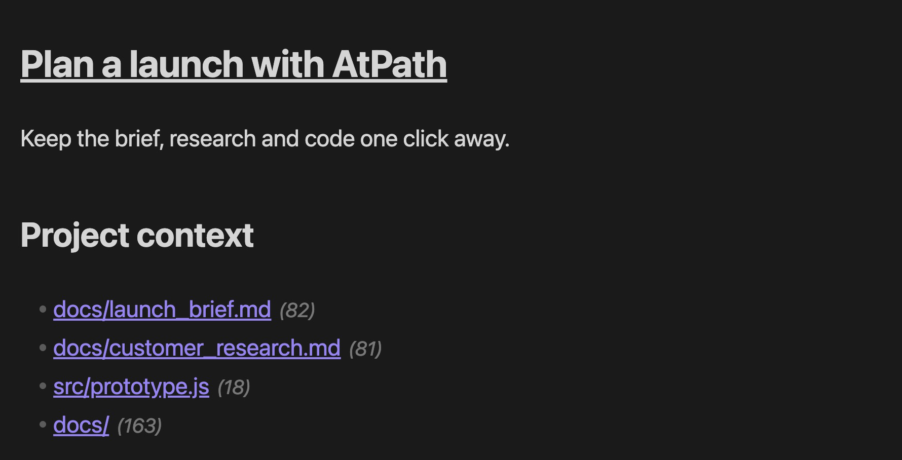
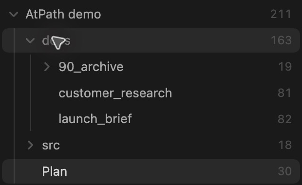

# AtPath

**Link your notes to project files, open the local copy, and see how much text context they contain.**

AtPath adds file and folder autocomplete, exact token counts, context copying, and web publishing to Obsidian. Links stay ordinary Markdown and work across Git repositories in your vault.

## Get started

This guide covers the **1.9.0 code on main**, requiring **Obsidian 1.15+**. Tagged releases may have an earlier feature set.

1. Copy [main.js](/main.js), [manifest.json](/manifest.json), and [styles.css](/styles.css) into your vault's `.obsidian/plugins/atpath/` folder, then enable **AtPath** under **Settings → Community plugins**. Use your configured settings folder if it differs from `.obsidian`.
2. Under **Settings → Files and links**, turn **Use Wikilinks** off.
3. Open a note inside a Git checkout in your vault. Type `[[`, search for a file or folder, and press **Enter**.

For tagged builds, use [Releases](https://github.com/sergiogportela/obsidian-atpath/releases) or add `sergiogportela/obsidian-atpath` through BRAT.

## Add and open links

Files in the note's repository rank first. Dragging files or folders from the explorer also inserts links: a blank line creates a bullet list; existing text keeps them inline.

| Target | Markdown saved in your note |
|---|---|
| Same repository | `[docs/brief.md](/docs/brief.md)` |
| Another repository | `[other_repo/docs/brief.md](https://github.com/owner/other_repo/blob/main/docs/brief.md)` |
| Folder | `[docs/](/docs/)` |

Click a link to open its **current local file**, even when the GitHub URL says `main` and your checkout is on another branch. Folder links reveal the folder. Right-click for **new tab**, **right split**, **new window**, **reveal**, **copy path**, or **open in default app**; desktop-only actions appear on desktop.

Backlinks and graph use the resolved local targets. Moves made through Obsidian update references. Existing `@path` links still work; your notes are not automatically converted.

## See and control token counts

Counts appear beside links, in the file explorer, and in the desktop status bar. Select text to count just that selection. Hover explorer or status counts for details.

In **Settings → AtPath → Exclude folders from parent totals**, enter one folder name or vault-relative path per line, then **Apply**. The default `90_archive` keeps old material out of parent totals and copied folder contents. You can still link to it directly. Clear the list to include all otherwise eligible folders.

Counts are exact for **o200k_base text tokens**, calculated locally and cached with content verification. They are not a complete AI request cost or an exact count for every model. Folder totals sum individual files; overlapping linked files count once. `k` abbreviations are rounded; `…` means pending, `!` means failed, and incomplete totals identify skipped files.

## Copy or publish

- **Collect context:** run **AtPath: Copy note with linked files to clipboard** from the command palette. It copies your current note plus linked text files in fenced blocks. Folders expand recursively; overlapping files appear once. Generated, sensitive and binary files are excluded, with limits and skipped-file reporting.
- **Share a page:** add a **Vercel API token** in AtPath settings, then run **AtPath: Publish current note to Vercel**. Review the domain, included files and access options before confirming. Private pages use Clerk. You can also publish an HTML file or static-site folder from an HTML file's explorer menu.

See the [reference](/docs/reference.md) for publishing setup, limits, cross-repository discovery, cache behavior and compatibility details. For development commands, see [AGENTS.md](/AGENTS.md).

[MIT license](/LICENSE)
