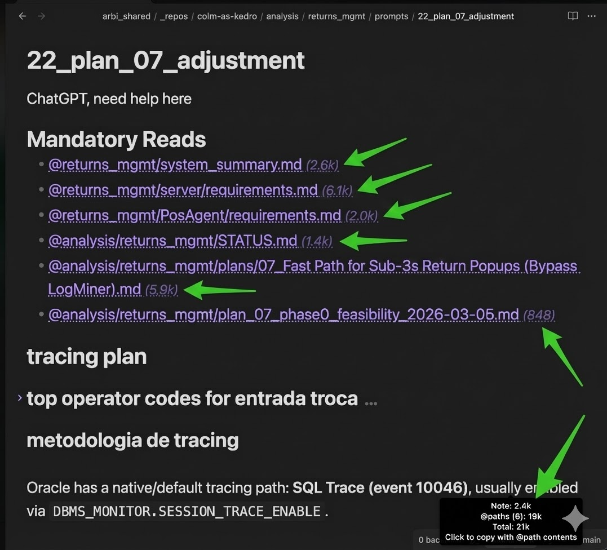
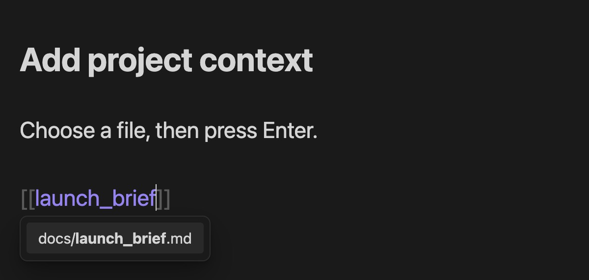
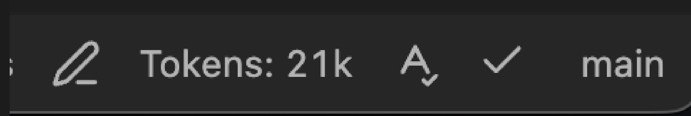
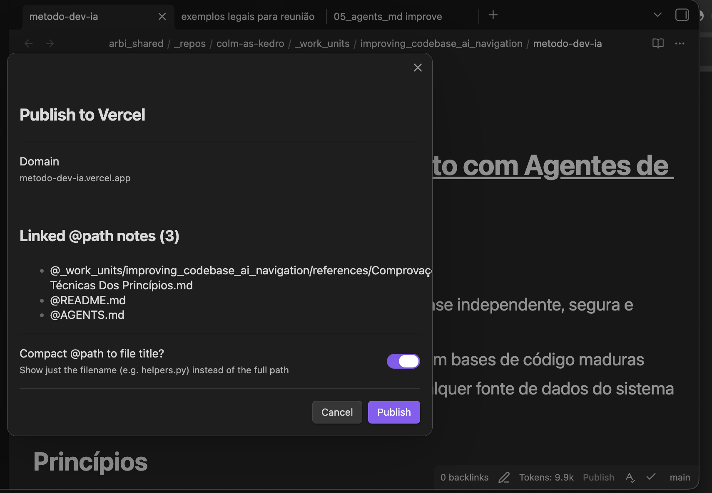
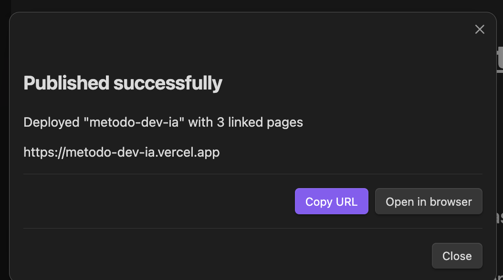

<div align="center">

# AtPath

**Write repository-aware Markdown links, open the local checkout, and see exact o200k_base text counts beside links and files.**

Autocomplete, click-to-open, token counting, one-click publish to the web, and cross-repo support.

[](https://github.com/sergiogportela/obsidian-atpath/releases)
[](LICENSE)

</div>

---

The repository-link migration is an unreleased 1.9.0 task-branch build for Obsidian 1.15 or newer. Screenshots below show the previous released UI.

<p align="center">
  
</p>

## Features

### Markdown autocomplete

Disable **Use Wikilinks**, type `[[`, and pick a file or folder. Files in the current repository rank first. AtPath inserts the destination and full path label together:

```markdown
[src/example.py](/src/example.py)
[other_repo/src/example.py](https://github.com/owner/other_repo/blob/main/src/example.py)
[other_repo/docs/](https://github.com/owner/other_repo/tree/main/docs/)
```

The containing note's innermost Git checkout defines `/`. Cross-repository links match Git origins, not local folder names. Opening, copying and counting always use local working files, regardless of the URL revision or checkout branch. A missing or ambiguous target produces a diagnostic; AtPath never switches branches or substitutes downloaded content.

<p align="center">
  
</p>

### Native backlinks and graph

An isolated compatibility layer supplies repository-aware references to Obsidian's native metadata index. It leaves note text unchanged and restores native resolution on unload. Desktop tests against Obsidian 1.15 verified backlink source passages and local/global graph inputs, including identical filenames in nested repositories. This uses internal APIs and checks their availability at runtime; mobile and full installed-plugin UI acceptance remain pending on this task branch.

Native Outgoing Links shows canonical destinations and navigates local files, including headings. If a note mixes a repository Markdown link with a native wikilink/embed using identical destination text, the repository row can display an internal key; the bridge preserves the native reference's original resolution in that ambiguous case.

Existing `@path` and AtPath wikilink references remain readable during migration. New authoring uses Markdown. The legacy-link preview identifies candidates without rewriting the vault automatically.

### Clickable Links

Click a repository link in Live Preview or Reading mode to open the local file, or reveal a folder. The desktop context menu can open the target in the default external application.

### Token Counts

Exact **o200k_base text-token** counts appear beside links, visible File Explorer rows, and in the desktop status bar. A lazy background worker uses pinned `gpt-tokenizer 4.1.0` with a bounded 10,000-piece merge cache. Counting stays local. Pending counts show `…`; partial folder totals and skipped files remain identified. Compact `k` labels are rounded for display; explorer/status tooltips show the full count. Explorer counts use faint text at 50% opacity.

A count describes the decoded text using this specific encoding. It is not an exact Claude count or a complete model request: message formatting, tools, instructions and history add tokens. Folder and linked totals sum individual file counts, with overlapping references deduplicated. They do not claim to count the assembled clipboard text, whose headings, fences and boundaries differ.

Failed counts show `!` and folder tooltips mark the total incomplete. A worker failure affects its active job; queued work continues in a fresh worker, with two automatic restarts per plugin session. The session limit prevents repeated bad files from causing an endless restart cycle. If recovery is exhausted, reload the plugin to retry. An unreadable file is logged and marked failed without claiming the whole counter stopped. Failed files are retried after a file modification or plugin reload; repeated display requests do not retry them.

The persistent cache lives in device-local IndexedDB, separate from synced settings. Its schema includes the tokenizer identity derived from the installed package version and a SHA-256 digest of the decoded text. At startup, every eligible file is read and hashed before its saved count is displayed; unchanged text avoids tokenization. Modification events invalidate counts even when size and timestamp stay unchanged. Pending reads/counts are discarded after edits, moves, deletion or unload. Failed checkpoints retry with exponential backoff up to five minutes and log once per failure streak; older heuristic caches are discarded.

**Exclude folders from parent totals** accepts one folder name or vault-relative path per line, with `90_archive` as the default. Select **Apply** to save the whole list; drafts do not change totals. Invalid stored settings fall back to the default with a notice. A name matches anywhere; `project/scratch` matches only that path. No glob syntax is needed. Matching folders are excluded from outside ancestor totals and copied folder expansions. They keep their own totals, and direct links to their files/folders still count and copy them. Nested matching folders form another boundary. Blank settings include all otherwise eligible folders. Changing this setting rebuilds totals without re-tokenizing files.

<p align="center">
  
</p>

### Copy note and linked contents

Copy the current editor buffer with referenced text files appended in fenced blocks. Folder references expand recursively, with file-size/count limits and skipped-file reporting. Overlapping file and folder references are deduplicated by local target path.

Counting, copy and linked-page collection exclude generated directories, Git/plugin metadata, binary content and sensitive filenames such as `.env`, private keys and `credentials.json`. Native indexed descendants define folder scope; explicitly linked eligible files outside the index are handled individually. AtPath's configurable defaults are 5 MB per file and 500 candidates per folder. The folder-boundary setting is an AtPath preference; AgentKit does not read it. AgentKit uses stricter dispatch limits of 1 MB per file, 100 files and 10 MB total; an AtPath count does not override those limits.

### Publish to Vercel

Deploy notes and standalone HTML apps to Vercel with one click. Notes can publish linked local content, while `.html` files in the File Explorer can publish either as a single-file app or as a whole folder-based static site. Included repository links are rewritten to their published pages by resolved target, independently of their display labels; the downloadable Markdown remains the original source.

The linked-page preview includes every eligible resolved local file linked from the main note, including ordinary Markdown links. Review that list before confirming publication. Links to local content excluded from the publication become inert text in the generated page.

Private publishing is supported through Clerk, and the publish flow also stores a reusable site icon so your deployed pages can show a favicon in browser tabs without asking every time.

Before publishing, the confirmation modal shows the target domain, current publish state, linked notes when relevant, and the main publish options for that content type.

<p align="center">
  
</p>

After deploying, a result modal gives you the URL with **Copy** and **Open in browser** buttons.

<p align="center">
  
</p>

Published pages include collapsible sections, foldable bold list items, inlined local images, a download button, and a configurable contact button.

### Cross-Repo References

Desktop discovery builds `repository-map.json` with vault-relative checkout roots and normalized GitHub identities. A mobile device consumes the synchronized map without needing `.git`. Configure the map's Sync coverage separately; excluded content remains unavailable on that device. The map contains no publishing credentials and describes one person's checkout layout.

The map also records local branches, tags and every remote's branches to disambiguate GitHub URL paths; remote HEAD pointers are omitted. It should be excluded from Git. Discovery skips every dot-directory and `data`, `node_modules`, `venv`, `dist`, `build`, `__pycache__` at every depth, and does not follow directory symlinks. Opening a note in such a tree verifies and adds only that exact checkout, without scanning its excluded descendants or siblings. Unverified desktop sources or unmapped mobile sources report a diagnostic instead of inheriting the wrong repository root.

AtPath retains verified opened checkouts in its personal map. AgentKit's fresh discovery adds only its current prompt source, so previously opened hidden checkouts can make AtPath's map differ from a fresh AgentKit inventory. Shared discovery fixtures cover the normal scan and current explicit source, not this retained history.

Use **Refresh repository map** after changes made outside Obsidian. Authenticated desktop GitHub rename lookup uses `gh` for unresolved names within known workspace organizations; it never downloads file content. URLs with an ambiguous slash-containing revision require a known ref boundary or explicit encoding and produce a diagnostic rather than a guessed path.

### Auto-Update References

AtPath updates repository links for file/folder moves performed through Obsidian, including source notes moved between repositories. Intentional commit-SHA destinations remain unchanged. Moving an entire checkout updates its map location instead of rewriting canonical references.

Pending moves are processed in order in one vault pass, including chained moves and swaps. Each note is parsed once unless it changes before the atomic update; concurrent edits are preserved. Legacy reference repair shares that pass. A failed note does not prevent other notes from updating, and a persistent notice identifies notes with incomplete updates. Checkout-root moves require a freshly verified repository map before any rewrite.

Only destinations change: existing labels, link titles, reference definitions, autolink syntax and non-main refs are preserved.

## Settings

| Setting | Default | Description |
|---------|---------|-------------|
| Show token counts | On | Exact o200k_base text counts in links, explorer and status bar |
| Max file size (MB) | 5 | Skip larger linked files when counting, copying or publishing |
| Max files per folder reference | 500 | Limit recursive folder expansion and its count by the number of indexed candidates before reading content |
| Exclude folders from parent totals | `90_archive` | One folder name or vault-relative path per line; excluded from ancestor totals and folder copying, still available directly |
| Show selection tokens in status bar | On | When text is selected, status bar shows `Sel: <selected> / <total>` |
| Suggest folders in autocomplete | On | Include folders in `[[` suggestions |
| Drag-and-drop link inserts | On | Insert a canonical Markdown link when dragging a file/folder |
| Vercel API token | — | For one-click publishing |
| Contact URL | — | Button link on published pages |
| Contact button label | Entre em contato | Button text |
| Site icon | — | Reusable favicon for published notes and HTML apps |
| Clerk publishable key | — | Required for private publishing |
| Clerk secret key | — | Required for private publishing |
| Publisher email | — | Used in private access requests |

## Install

- **Community Plugins** — in Obsidian, open `Settings` -> `Community plugins` -> `Browse`, search for `AtPath`, install, then enable
- **BRAT** — install `BRAT` from Obsidian Community Plugins, open `Settings` -> `BRAT`, choose `Add beta plugin`, enter `https://github.com/sergiogportela/obsidian-atpath`, then enable `AtPath`
- **Release zip** — download `atpath-x.y.z.zip` from the latest release, extract it into `.obsidian/plugins/` so it creates `.obsidian/plugins/atpath/`, then enable or reload the plugin
- **Manual** — copy `main.js`, `manifest.json`, `styles.css` to `.obsidian/plugins/atpath/`, then enable or reload the plugin

## Contributing

Contributions are welcome! Feel free to open issues or submit pull requests.

## License

MIT
